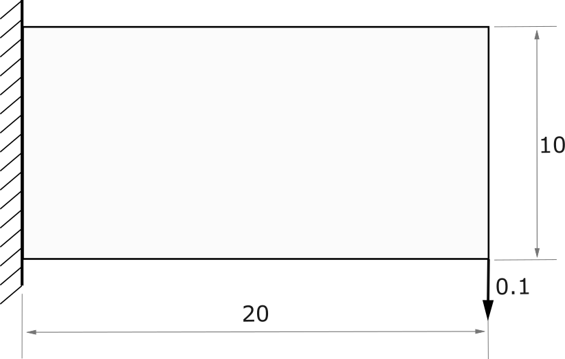
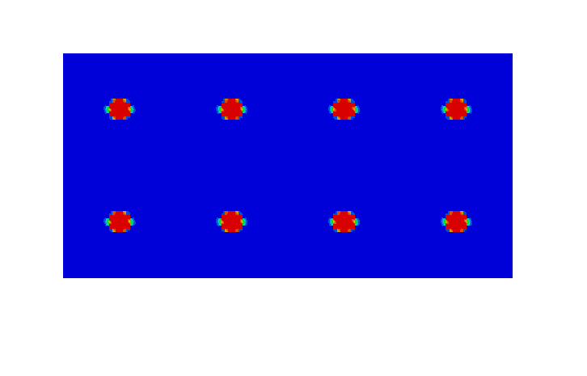

# Geometry Projection Topology Optimization via using ABAQUS to run Finite Element Analysis (FEA)

The educational code for Geometry Projection Topology Optimization using off-the-shelf software ABAQUS with User Material Subroutine (UMAT) to run FEA

Version 1.0.1 -- October 2026

Nguyen Anh Tuan and Julian Norato
School of Mechanical, Aerospace, and Manufacturing Engineering

The python code performs the feature mapping method of topology optimization GPTO for stuctures made of geometric primitives. The primary objective of this code is to implement/embed the geometry projection method into UMAT using FORTRAN code which helps solving FE models easier and more efficient. For detail description of the geometry projection formulation, please refer to the journal paper *A MATLAB code for topology optimization using geometry projection method* (https://doi.org/10.1007/s00158-020-02552-0). The technique also is applied to off-the-shelf software LS-DYNA in the paper *Topology Optimization of Sandwich Truss Cores for Improved Plastic Energy Absorption* (https://doi.org/10.1115/1.4071234)

## Installation

- The Python code of the method of moving asymptotes `MMA.py` [1, 2, 3] is now contributed in GPTO. The acknowledgement of this code to Prof. Svanberg kindly making freely available.

- This program is distributed under a **MIT License**, which means it is free for educational use and that appropriate credit must be given. The program is not open source in which users can contribute to futher development of the code is not available. Nevertheless, the authors welcome any suggestions and recommendations for future improvements. In no event shall the University of Connecticut or the contributors be held liable for damages incurred by the use of this software.

Python version Python/3.10.5

ABAQUS version 2023

Intel FORTRAN compiler intel-oneapi/2022.3

### 1.3 System requirement

If you are planning to use **fmincon**, then the Python must have the `scipy.sparse, scipy.optimize, scipy.io` packages. The code has been tested using versions Python/3.10.5 in the Red Hat Enterprise Linux 8.9 and Windows 11 operative systems.

### 1.4 Testing

To use the code, simply download it and uncompress it, maiking sure folder structure is perserved. To test it, make sure having `Abaqus_Python.py` to run ABAQUS software in RHEL 8.9 or Windows 11 operative systems. The main script to run the program is on `GPTO_main.py` 

This program consists of the design of 2D cantilever beam `ZOpt_MMA.inp` and 3D cantilever beam `GPTO_3D.inp` which is generated via ABAQUS CAE with the dimension, loading and boundaries condition (BC), and finite element analysis are set up. If the code runs successfully, it should converge and produce a convergence plot at the end of the optimization.

## 2 Tutorial - 2D Cantilever beam

As mention the previous section, the mesh generation, loading and boundary condition, finite element model in `.inp` files are generated by ABAQUS. The program has a few input parameters related to initial deisn, geometry projection, optimization and output. All of these parameters should be specified as **input_files** cantilever2d `inputs_cantilever2d.py` and cantilever3d such as `inputs_cantilever3d.py`

The dimensions, loading and boundary conditions (BCs) for the 2D cantilever beam are shown in the following figure. The magnitude of the load is $F = 0.1$. The volume fraction constraint for this problem is $v^*_f = 0.3$.

<table>
  <tr>
    <td align="center">
      
       
      (a) Loading and Boundary Condition
    </td>
    <td align="center">
      
       
      (b) Initial design
    </td>
  </tr>
</table>

### 2.1 Input files

The dimensions of design region is specified and used later such as scaling factor:

    FE['mesh_input']['box_dimensions'] = np.array( (20,10) )

We also need to let the input file the location of the file with specification of the bars that make up the initial design (which we can modify according to users)

    GEOM['initial_design'] = { 
    'path':'input_files/cantilever2d/initial_cantilever2d_geometry.py' ,
    'plot':plot_cond ,
    'restart':False}

For this problem, we use bars of a fixed width $r_b = 0.5$. We will also use the MMA optimizer. In this case, we assign lower and upper bounds to the bar radii that are slightly different:

    GEOM['min_bar_radius'] = 0.5
    GEOM['max_bar_radius'] = 0.501

If using **fmincon** as an optimizer, the lower and upper bounds on $r_b$ need to be imposed a fixed radius simply make the two bounds equal

To impose the volume fraction constraint of $v^*_f =0.3$, use the following line:

    OPT['functions']['constraint_limit'] = [0.3]

We could use the default option as **fmincon** or the MMA optimizer. To switch to the optimizer, modify the line:

    # OPT['options']['optimizer'] = 'default'
    OPT['options']['optimizer'] = 'mma'

Finally, we can tolerate a stopping criterion for the relative change in the design variables

    OPT['options']['step_tol'] = 1e-3

### 2.2 Specifying the initial design

For this problem, we will use the initial design shown above, which consists of 8 floating bars (bars do not share endpoints), and therefore there are 16 separate endpoints. The size variable $\alpha_b$ for each bar in the initial design is assigned to 0.5 and the bar radius $r_b$ to 0.5.

For `point_matrix`, the first column in the array contains an integer index for each point, the second and the third columns correspond to the x- and y-coordinates.

`bar_matrix`: the first column contains an integer index for each bar; the second and third columns are the integer IDs of the endpoints of the medial asix; the fourth , and fifth column are the value of membership variable and the width of the bar in the initial design, respectively.

It is notable that the length of the bars initial design must not equal to zero, which is simply accomplished by making sure that the coordinates of the two endpoints of the axis of the bar do not coincide

### 2.3 Running the optimization

To run the optimization, simply execute the `GPTO_main.py` script. The actual design you obtain may be different depending on the type and version of the optimizer, and it may take a different number of iterations to converge.

## 3 Parameters in the input file `inputs_cantilever2d.py`

This section provides a listing of the meaning and options of all the parameters in the input file.

**GEOM['inputFile']**: variable indicate the name of the finite element model generated by ABAQUS `.inp`

**GEOM['userFile']**: the user material subroutine that consists of the geometry projection method that compute the combined densities and then assign the Ersatz material on each element 

**plot_cond** : Options: `true` or `false`. Turn on or off plotting of figures during the optimization

### Material properties

The material properties are identified in `ZOpt_MMA.inp` file at the key `*User Material, constants=2` with Elasticity $E = 1.$, and Poisson's ratio of the material $\mu = 0.3$.
 
 ### Initial design

 **GEOM['initial_design']['path']**: A string with the path and name of a file containing the bars that make up the initial design

 ### Optimization problem

 **OPT['functions']['objective']**: A string with the name of the objective function. This is a string corresponding to the name given to the function in the list of functions to be computed (`int_optimization` function in `optimization.py`). For this educational code, this parameter is `'compliance'`.

 **OPT['functions']['constraints']**: A cell array with the names of the functions that are constraints in the optimization. These names correspond to the names given the functions in the list of functions to be computed `int_optimization`. For this educational code, the parameter is `'volume fraction'`.

 **OPT.['functions']['constraint_limit]: A one-dimentional array with the values of the constraint limits for inequality constraints. As customary in nonlinear programming, all inequality constraints should be of the form '$\le$'.

### Geometry projection

**OPT['parameters']['elem_r']**: Sample window radius $r_e$. By default, this parameter is commented out, and this radius is automatically computed by the code as the radius of the circle (in 2D) or sphere (in 3D) that circumscribes each element. If uncommented, the value you provide will overwrite the default, and must be given as an absolute dimension.

**OPT['parameters']['smooth_max_scheme']**: Options: 'MOD_P-NORM', 'MOD_P-MEAN', 'KS', and 'KS_UNDER'. Smooth maximum function to combine multiple effective densities into single combined density. These functions are defined in the `def smooth_max`.

**OPT['parameters']['smooth_max_param']**: Parameter for the smooth maximum function.

**OPT['parameters']['penalization_scheme']**: Options: `'SIMP'`, `'RAMP'`. Penalization function $\mu$ to compute effective density

**OPT['parameters']['penalization_param']**: Parameter for the penalization function.

### Optimization and output

**OPT['options']['dv_scaling']**: Options: `true` or `false`. If `true`, scale design variables so that they all lie within the [0, 1] interval.

**OPT['options']['move_limit']**: Move limit on design update at each iteration

**OPT['options']['max_iter']**: Maximum number of iteration for the optimization.

**OPT['options']['step_tol']**: Stopping criterion for the relative change in design variables, computed as the 2-onrm of the difference between the vectors of design variables for two consecutive iterations.

**OPT['options']['kkt_tol']**: Stopping criterion for optimality, measured as the 2-norm of the Karush-Kuh-Tucker (KKT) optimality conditions.

### Finite difference check of sensitivities

**OPT['make_fd_check']**: Options: `true` or `false`. If `true`, perform forward finite difference check of analytical sensitivities.

**OPT['fd_step_size']**: Size of the finite difference perturbation

**OPT['check_cost_sens']**: Options: `true` or `false`. If `true`, perform finite difference check of the sensitivities of the cost (objective) function.

**OPT['check_cons_sens']**: Options: `true` or `false`. If `true`, perform finite difference check of the sensitivities of the constraint function.

## Reference

[1] Krister Svanberg, **The method of moving asymptotes -- a new method for structural optimization**, *International Journal for Numerical Methods in Engineering*, 24(2): 359-373, 1987. https://doi.org/10.1002/nme.1620240207.

[2] Krister Svanberg, **A class of globally convergent optimization methods based on conservative convex separable approximations**, *SIAM Journal on Optimization*, 12(2): 555-573, 2002. https://doi.org/10.1137/S1052623499362822

[3] Krister Svanberg, **MMA and GCMMA, versions september 2007**, *Optimiztion and Systems Theory*, page 104, 2007
